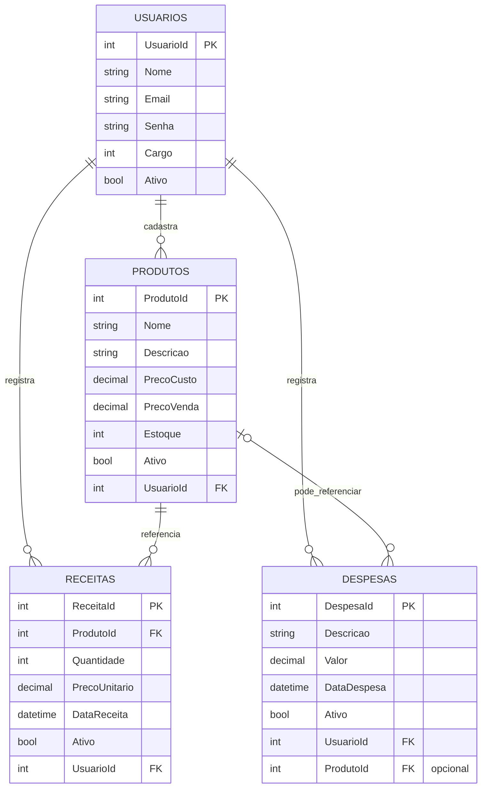

# DermaFer360 --- Documentação do Projeto

**Projeto de conclusão \| Governança financeira para empresa de
dermocosméticos**\
**Versão da documentação:** 1.0\
**Tecnologias principais:** React, ASP.NET Core 8, C#, SQL Server e Ollama


## 1. Introdução

### 1.1 Nome e descrição do projeto

O **DermaFer360** é uma aplicação web para apoiar a organização e o
acompanhamento financeiro de uma empresa de dermocosméticos. O sistema
reúne cadastros de usuários e produtos, registros de receitas e
despesas, consulta de indicadores financeiros e uma área de perguntas e
respostas com inteligência artificial.

### 1.2 Problema e público-alvo

O projeto busca centralizar informações que podem ficar dispersas em
planilhas ou registros separados, facilitando a consulta de
movimentações e a visualização de resultados. O público-alvo são
profissionais e gestores que precisam acompanhar produtos e informações
financeiras de uma empresa de dermocosméticos.

### 1.3 Objetivos

-   Cadastrar e consultar produtos, usuários, receitas e despesas.
-   Calcular resultados financeiros para períodos informados.
-   Exibir indicadores, gráfico financeiro e receitas recentes em um
    dashboard.
-   Controlar o acesso à aplicação por autenticação com token JWT.
-   Oferecer uma interface de perguntas sobre conceitos financeiros e
    consultas de determinados períodos com apoio de IA local.

### 1.4 Escopo e limitações

A versão documentada inclui os módulos descritos neste documento. O
sistema é um projeto acadêmico/de demonstração e deve ser validado antes
de uso empresarial real. A resposta da IA é auxiliar e não substitui a
conferência dos registros oficiais. A integração com IA depende do
Ollama estar instalado e com o modelo configurado. A configuração local
de banco, endereço da API e segredo JWT precisa ser adaptada ao
ambiente. Não foi realizada nesta documentação uma execução automatizada
completa de todos os fluxos.

## 2. Visão geral do sistema

### 2.1 Arquitetura

A solução é dividida em uma aplicação React e uma API ASP.NET Core. O
React envia requisições HTTP para a API usando Axios. A API recebe as
requisições pelos controllers, delega regras às classes da camada
Aplicação e utiliza repositórios com Entity Framework Core para acessar
o SQL Server.

Fluxo principal:

`Pessoa usuária → React → Axios/HTTP → Controllers da API → Aplicação → Repositórios/Entity Framework Core → SQL Server`

Para a funcionalidade de IA:

`React → POST /IA/Perguntar → IAController → IAAplicacao → Ollama local (HTTP)`

Quando a pergunta é identificada como consulta financeira e informa um
período reconhecido, o controller consulta o serviço de relatório e
devolve os totais calculados pelo sistema, em vez de depender da IA para
fazer a conta.

### 2.2 Camadas da API

-   **DermaFer360.Api:** camada de apresentação HTTP; contém
    controllers, modelos de requisição/resposta, configuração de
    autenticação, CORS e Swagger.
-   **DermaFer360.Aplicacao:** coordena os casos de uso e regras de
    aplicação, como cadastro, atualização, consulta e cálculo de
    relatórios.
-   **DermaFer360.Dominio:** contém entidades e tipos do domínio,
    incluindo Produto, Receita, Despesa, Usuario e enumeradores de
    cargo.
-   **DermaFer360.Repositorio:** contém o `DbContext`, configurações do
    Entity Framework Core, migrations e repositórios para persistência
    no SQL Server.
-   **DermaFer360.Service:** projeto presente na solução; confirme seu
    uso efetivo antes de atribuir a ele responsabilidades específicas,
    pois a estrutura analisada não evidenciou serviços implementados
    nele.

### 2.3 Funcionalidades

-   **Login:** autenticação por e-mail e senha; a API retorna os dados
    de autenticação e token.
-   **Dashboard financeira:** filtro por data inicial/final, cards com
    receitas, despesas, lucro e estoque, gráfico e últimas receitas.
-   **Usuários:** cadastro, consulta, edição, alteração de senha,
    exclusão, restauração, listagem e consulta de cargos.
-   **Produtos:** cadastro, consulta, edição, exclusão e listagem, com
    nome, descrição, preço de custo, preço de venda, estoque e status.
-   **Receitas:** registro e manutenção de receitas vinculadas a
    produto, quantidade, preço unitário, data e usuário.
-   **Despesas:** registro e manutenção de despesas.
-   **Relatório financeiro:** consolidação de receitas e despesas no
    período, incluindo quantidades e lucro.
-   **DermaFer IA:** perguntas sobre conceitos financeiros e consultas
    financeiras para períodos reconhecidos pela implementação.

## 3. Tecnologias utilizadas

  -----------------------------------------------------------------------
  Área                    Tecnologia / ferramenta Finalidade
  ----------------------- ----------------------- -----------------------
  Front-end               JavaScript, React 18    Construção da interface

  Navegação               React Router DOM        Rotas e páginas

  Requisições HTTP        Axios                   Comunicação com a API

  Interface               React Bootstrap,        Componentes e estilos
                          Bootstrap, React Icons, 
                          CSS Modules             

  Gráficos                Recharts                Visualização de dados
                                                  financeiros

  Back-end                C#, ASP.NET Core 8      API REST

  Documentação da API     Swagger / Swashbuckle   Exploração e teste de
                                                  endpoints

  Persistência            SQL Server              Armazenamento dos dados

  ORM e migrations        Entity Framework Core 8 Mapeamento
                                                  objeto-relacional e
                                                  evolução do banco

  Segurança               JWT Bearer              Autenticação por token

  IA local                Ollama e modelo         Respostas da DermaFer
                          configurado localmente  IA
                          (por exemplo,           
                          `phi3:mini`, se esse    
                          for o modelo instalado) 

  Ferramentas             Visual Studio Code ou   Desenvolvimento e
                          Visual Studio, .NET SDK versionamento
                          8, Node.js/npm,         
                          Git/GitHub              
  -----------------------------------------------------------------------

As versões exatas das bibliotecas do front-end estão registradas em
`package.json` e `package-lock.json`; as dependências do back-end estão
nos arquivos `.csproj`.

## 4. Requisitos do sistema

### 4.1 Requisitos de software

-   Windows, Linux ou macOS compatível com .NET 8 e Node.js.
-   .NET SDK 8 instalado.
-   Node.js e npm instalados.
-   SQL Server instalado e acessível (a configuração original usa uma
    instância local `SQLEXPRESS`).
-   Git para clonar/versionar o repositório.
-   Ollama instalado e em execução para utilizar a funcionalidade de IA.
-   Navegador atualizado.

### 4.2 Requisitos de hardware

Para desenvolvimento local, recomenda-se computador com processador de
64 bits, pelo menos 8 GB de RAM e espaço livre para SDKs, dependências e
banco de dados. O uso de modelos locais de IA pode exigir mais memória,
dependendo do modelo escolhido.

## 5. Configuração e execução local

### 5.1 Obter os códigos

Clone os repositórios do GitHub ou coloque as pastas da API e do
front-end em diretórios locais. Abra um terminal em cada pasta.

### 5.2 Configurar o SQL Server

1.  Inicie o serviço do SQL Server.
2.  Crie ou confirme a existência do banco `DermaFer360`.
3.  Ajuste `ConnectionStrings:DefaultConnection` no
    `appsettings.Development.json` ou em configuração segura equivalente
    para a instância e autenticação do seu computador.
4.  Não use no GitHub nomes de máquina, credenciais ou segredos
    pessoais.
5.  Aplique as migrations do Entity Framework Core a partir da pasta da
    solução/projeto de repositório, com o projeto de API definido como
    projeto de inicialização quando necessário. Exemplo, ajustando os
    caminhos conforme a solução:

``` bash
dotnet ef database update --project DermaFer360.Repositorio --startup-project DermaFer360.Api
```

Se o comando `dotnet ef` não estiver disponível, instale a ferramenta do
Entity Framework Core compatível com a versão 8. Confirme que a
migration e a conexão apontam para o banco correto antes de executar.

### 5.3 Configurar e iniciar a API

1.  Abra o terminal na pasta `DermaFer360.Api`.
2.  Confira a connection string e as configurações JWT por variáveis de
    ambiente ou `appsettings.Development.json` não versionado.
3.  Restaure e compile:

``` bash
dotnet restore
dotnet build
dotnet run
```

4.  Consulte o endereço indicado no terminal. Em ambiente de
    desenvolvimento, o Swagger é habilitado pelo código quando o
    ambiente é `Development`. A URL exata pode variar conforme
    `launchSettings.json`.
5.  A configuração do React fornecida utiliza `http://localhost:5026`
    como `baseURL`. Se a API iniciar em outra porta, atualize
    `src/services/ClientApiService.js` ou centralize essa configuração
    em variável de ambiente.
6.  A API configura CORS para `http://localhost:3000`; altere a política
    se o front-end usar outra origem.

### 5.4 Configurar e iniciar o React

Na pasta do front-end:

``` bash
npm install
npm start
```

O Create React App normalmente abre `http://localhost:3000`. Confirme
que a URL corresponde à política CORS da API e à `baseURL` configurada
no Axios.

### 5.5 Configurar a IA local

1.  Instale o Ollama e inicie seu serviço local.
2.  Baixe e configure o modelo que a implementação utilizará. O endereço
    definido na API é `http://localhost:11434/`.
3.  Confira o nome do modelo utilizado no código de `IAAplicacao` e
    baixe exatamente esse modelo no Ollama.
4.  Teste primeiro se a API e o Ollama respondem antes de testar a tela
    `/ia`.

Se a IA não responder, verifique se o Ollama está ativo, se o modelo
está instalado, se a porta está correta e se a API consegue acessá-lo.

## 6. Desenvolvimento e estrutura dos diretórios

### 6.1 API

``` text
DermaFer360.API/
├── DermaFer360.Api/
│   ├── Controllers/
│   ├── Models/
│   ├── Program.cs
│   └── appsettings.json
├── DermaFer360.Aplicacao/
│   ├── DTO/
│   ├── Interfaces/
│   └── classes de aplicação
├── DermaFer360.Dominio/
│   ├── Entidades/
│   ├── Enumeradores/
│   └── Dtos/
├── DermaFer360.Repositorio/
│   ├── Configuracoes/
│   ├── Context/
│   ├── Interfaces/
│   ├── Migrations/
│   └── repositórios
└── DermaFer360.Service/
```

### 6.2 Front-end

``` text
src/
├── components/       # Layout, menu, barra superior, cards e gráfico
├── pages/            # Login, dashboard, usuários, produtos, receitas,
│                     # despesas, relatório e inteligência artificial
├── services/         # Comunicação HTTP com os endpoints da API
├── assets/           # Imagens e identidade visual
├── App.js            # Definição das rotas
└── index.css         # Estilos globais
```

### 6.3 Comunicação entre componentes

As páginas React usam serviços como `ProdutoService`, `ReceitaService`,
`DespesaService`, `UsuarioService`, `RelatorioService` e `IAService`.
Esses serviços centralizam as chamadas HTTP no cliente Axios. O cliente
acrescenta o token JWT no cabeçalho `Authorization` quando existe token
no armazenamento local e redireciona para o login ao receber resposta
HTTP 401.

### 6.4 Regras e validações

As regras de negócio ficam principalmente na camada Aplicação. Os
controllers convertem os modelos recebidos em objetos de domínio e
retornam respostas HTTP. Os repositórios executam consultas e gravações.
Datas dos relatórios devem ser enviadas em formato válido e a data
inicial não deve ser posterior à data final.

## 7. API REST

A rota base usa o nome do controller. Os endpoints abaixo foram
identificados no código fornecido. Confirme no Swagger o endereço
efetivo e os esquemas exatos dos campos antes de integrar clientes
externos.

  --------------------------------------------------------------------------------------------------------------------
  Método                  Endpoint                                                             Finalidade
  ----------------------- -------------------------------------------------------------------- -----------------------
  POST                    `/Autenticacao/Login`                                                Autenticar e obter
                                                                                               token

  POST                    `/Usuario/Criar`                                                     Criar usuário

  GET                     `/Usuario/Obter/{usuarioId}`                                         Consultar usuário por
                                                                                               ID

  PUT                     `/Usuario/Atualizar`                                                 Atualizar usuário

  PUT                     `/Usuario/AlterarSenha`                                              Alterar senha

  DELETE                  `/Usuario/Deletar/{usuarioId}`                                       Remover/inativar
                                                                                               usuário conforme regra
                                                                                               implementada

  PUT                     `/Usuario/Restaurar/{usuarioId}`                                     Restaurar usuário

  GET                     `/Usuario/Listar`                                                    Listar usuários

  GET                     `/Usuario/ListarCargos`                                              Listar cargos
                                                                                               disponíveis

  POST                    `/Produto/Criar`                                                     Cadastrar produto

  GET                     `/Produto/Obter/{produtoId}`                                         Consultar produto

  PUT                     `/Produto/Atualizar`                                                 Atualizar produto

  DELETE                  `/Produto/Deletar/{produtoId}`                                       Remover produto

  GET                     `/Produto/Listar`                                                    Listar produtos

  POST                    `/Receita/Criar`                                                     Registrar receita

  GET                     `/Receita/Obter/{receitaId}`                                         Consultar receita

  PUT                     `/Receita/Atualizar`                                                 Atualizar receita

  DELETE                  `/Receita/Deletar/{receitaId}`                                       Remover receita

  GET                     `/Receita/Listar`                                                    Listar receitas

  POST                    `/Despesa/Criar`                                                     Registrar despesa

  GET                     `/Despesa/Obter/{despesaId}`                                         Consultar despesa

  PUT                     `/Despesa/Atualizar`                                                 Atualizar despesa

  DELETE                  `/Despesa/Deletar/{despesaId}`                                       Remover despesa

  GET                     `/Despesa/Listar`                                                    Listar despesas

  POST                    `/Relatorio/RelatorioFinanceiro`                                     Gerar relatório por
                                                                                               período

  GET                     `/Relatorio/Dashboard?dataInicial=AAAA-MM-DD&dataFinal=AAAA-MM-DD`   Consultar dados do
                                                                                               dashboard

  POST                    `/IA/Perguntar`                                                      Enviar pergunta à
                                                                                               DermaFer IA
  --------------------------------------------------------------------------------------------------------------------

### 7.1 Exemplo: login

Requisição:

``` http
POST /Autenticacao/Login
Content-Type: application/json
```

O corpo deve seguir o modelo `LoginAutenticacao` exposto pelo Swagger.
Exemplo ilustrativo:

``` json
{
  "email": "usuario@exemplo.com",
  "senha": "senha-de-teste"
}
```

A resposta de sucesso contém os dados de autenticação definidos pela
API, incluindo o token utilizado nas chamadas protegidas. Não reutilize
senhas reais em testes ou documentação.

### 7.2 Exemplo: consultar dashboard

``` http
GET /Relatorio/Dashboard?dataInicial=2026-10-01&dataFinal=2026-10-31
Authorization: Bearer SEU_TOKEN_JWT
```

O formato da resposta é um objeto com os dados do dashboard e uma
mensagem. Os nomes e tipos dos campos devem ser conferidos no Swagger e
no DTO de dashboard.

### 7.3 Exemplo: gerar relatório financeiro

``` http
POST /Relatorio/RelatorioFinanceiro
Content-Type: application/json
Authorization: Bearer SEU_TOKEN_JWT
```

``` json
{
  "dataInicial": "2026-10-01",
  "dataFinal": "2026-10-31"
}
```

A resposta inclui o relatório calculado e uma mensagem de confirmação.

### 7.4 Exemplo: perguntar à IA

``` http
POST /IA/Perguntar
Content-Type: application/json
Authorization: Bearer SEU_TOKEN_JWT
```

``` json
{
  "pergunta": "O que é margem de lucro?"
}
```

Para consultas financeiras por período, exemplos compatíveis com a
lógica identificada são: "Qual foi o lucro em outubro de 2026?" ou "Qual
foi o resultado financeiro de 01/10/2026 a 31/10/2026?". O sistema
precisa reconhecer o período informado; se não reconhecer, solicitará
que a pessoa especifique o período.

### 7.5 Códigos HTTP comuns

-   `200 OK`: operação concluída.
-   `400 Bad Request`: dados inválidos, validação ou erro de regra de
    negócio.
-   `401 Unauthorized`: token ausente, inválido ou expirado em endpoint
    protegido.
-   `500 Internal Server Error`: falha inesperada, inclusive possível
    indisponibilidade do serviço de IA.

A autorização deve ser conferida endpoint por endpoint no
código/Swagger. A existência de configuração JWT na API não significa,
por si só, que todos os endpoints estejam protegidos por atributo
`[Authorize]`.

## 8. Interface do usuário

-   **Login (`/`):** formulário de acesso; após autenticação, o token é
    armazenado no navegador.
-   **Dashboard (`/dashboard`):** indicadores de receita, despesa, lucro
    e estoque, filtros de datas, gráfico e receitas recentes.
-   **Usuários (`/usuarios`):** lista e manutenção de usuários, com
    telas para novo cadastro e edição.
-   **Produtos (`/produtos`):** lista e manutenção dos produtos.
-   **Receitas (`/receitas`):** consulta, cadastro e edição de receitas.
-   **Despesas (`/despesas`):** consulta, cadastro e edição de despesas.
-   **Relatório financeiro (`/relatorio-financeiro`):** consulta
    consolidada por período.
-   **DermaFer IA (`/ia`):** chat para perguntas, envio com botão ou
    Enter e limpeza da conversa.

As páginas, estilos e componentes estão organizados em `src/pages`,
`src/components` e `src/services`. As rotas de negócio, exceto o login,
são envolvidas pelo componente `RotaPrivada` no React. A proteção do
front-end melhora a experiência, mas não substitui a autorização no
servidor.

## 9. Banco de dados

### 9.1 Entidades principais

-   **Usuario:** dados de acesso, nome, e-mail, cargo e situação.
-   **Produto:** nome, descrição, preço de custo, preço de venda,
    estoque e situação.
-   **Receita:** produto relacionado, quantidade, preço unitário, data,
    usuário relacionado e situação.
-   **Despesa:** registro de despesa e os campos definidos na entidade
    de domínio.

O `DermaFer360Context` declara conjuntos para usuários, produtos,
receitas e despesas. As relações e restrições são configuradas nas
classes em `Repositorio/Configuracoes`. O repositório inclui migrations
do Entity Framework Core, inclusive alterações de relacionamento e uma
migration relacionada à procedure de relatório.

### 9.2 Diagrama de Entidade-Relacionamento (ERD)

O diagrama abaixo representa as entidades e os relacionamentos identificados nas configurações do Entity Framework Core. O GitHub renderiza este diagrama Mermaid ao visualizar o README.



**Leitura do diagrama:** um usuário pode cadastrar vários produtos e registrar várias receitas e despesas. Cada receita está relacionada a um produto e a um usuário. Uma despesa está relacionada a um usuário e pode estar associada a um produto; essa associação é opcional. O diagrama é lógico, baseado no código. Confira o esquema físico após aplicar as migrations ao banco.

### 9.3 Relatórios

O relatório financeiro agrega receitas e despesas de um intervalo e
apresenta totais, lucro e quantidades de registros. O projeto contém
migrations relacionadas à criação de uma procedure de relatório;
confirme a migration aplicada no banco antes de afirmar que a procedure
existe no ambiente.

## 10. Segurança e configuração

-   A API configura autenticação JWT Bearer e valida emissor, público,
    validade e assinatura.
-   O cliente React envia o token em `Authorization: Bearer ...` quando
    ele está armazenado.
-   O CORS está configurado para a origem local `http://localhost:3000`.
-   **Antes de publicar:** retire chaves JWT de arquivos versionados,
    use variável de ambiente ou Secret Manager, troque qualquer segredo
    de desenvolvimento e nunca comite senhas ou dados pessoais.
-   A connection string atual do arquivo fornecido é específica de uma
    máquina. Substitua-a por uma configuração local não versionada.
-   Verifique se os endpoints que alteram dados financeiros exigem
    autorização e se há autorização por perfil/cargo. JWT sozinho não
    implementa automaticamente autorização por função.
-   Não armazene senhas em texto puro; confirme que a implementação
    utiliza hash seguro e revise o fluxo de alteração de senha antes de
    uso real.
-   Use HTTPS também fora do ambiente local e valide entradas, erros e
    logs para não expor informações internas.

## 11. Decisões técnicas e desafios

### 11.1 Decisões técnicas

-   Separação da API em camadas para organizar responsabilidades e
    facilitar manutenção.
-   React para a interface e serviços Axios para concentrar a
    comunicação com a API.
-   SQL Server e Entity Framework Core para persistência e evolução do
    esquema via migrations.
-   JWT para autenticação entre front-end e API.
-   Swagger para explorar e testar endpoints durante o desenvolvimento.
-   Ollama para disponibilizar um modelo de IA local, reduzindo a
    dependência de um serviço remoto para a conversa.

### 11.2 Desafios identificados no desenvolvimento

-   Configuração de conexão com instância local do SQL Server.
-   Registro das interfaces e implementações na injeção de dependência.
-   Integração de token JWT entre login, Axios e rotas privadas.
-   Ajustes de migrations e relacionamentos do banco.
-   Validação dos filtros de datas para evitar período invertido.
-   Integração do serviço local Ollama com a API e tratamento de falhas.

### 11.3 Boas práticas recomendadas

-   Validar dados na camada de aplicação e também por meio de validações
    de entrada.
-   Manter segredos fora do GitHub.
-   Criar testes unitários para cálculos e validações de período.
-   Criar testes de integração para endpoints principais.
-   Registrar logs técnicos sem incluir senhas, tokens ou dados
    sensíveis.
-   Manter documentação dos DTOs e exemplos de resposta sincronizados
    com o Swagger.
-   Fazer backup do banco e revisar permissões por cargo.

## 12. Requisitos funcionais e histórias de usuário

### 12.1 Requisitos funcionais

-   **RF01:** o sistema deve autenticar usuários por e-mail e senha.
-   **RF02:** o sistema deve permitir cadastrar, listar, consultar,
    editar e remover produtos.
-   **RF03:** o sistema deve permitir manter usuários e seus cargos.
-   **RF04:** o sistema deve permitir registrar e consultar receitas.
-   **RF05:** o sistema deve permitir registrar e consultar despesas.
-   **RF06:** o sistema deve gerar relatório financeiro para um período.
-   **RF07:** o dashboard deve exibir indicadores financeiros, gráfico e
    receitas recentes.
-   **RF08:** o sistema deve permitir perguntas à DermaFer IA.
-   **RF09:** o sistema deve exigir token nas operações que forem
    configuradas como protegidas.

### 12.2 Histórias de usuário

-   Como pessoa administradora, quero gerenciar usuários para controlar
    quem acessa o sistema.
-   Como pessoa responsável pelo estoque, quero cadastrar produtos com
    custos, preços e quantidade para manter os dados organizados.
-   Como pessoa do financeiro, quero registrar receitas e despesas para
    acompanhar as movimentações.
-   Como pessoa gestora, quero filtrar o dashboard por período para
    avaliar o resultado financeiro.
-   Como pessoa gestora, quero gerar um relatório financeiro para
    comparar receitas, despesas e lucro.
-   Como pessoa usuária, quero consultar a DermaFer IA para entender
    conceitos financeiros e apoiar minhas análises.

## 13. Plano de desenvolvimento (roadmap)

1.  **Base do projeto:** estrutura em camadas, configuração do banco e
    migrations.
2.  **Cadastros:** usuários, produtos, receitas e despesas.
3.  **Relatórios:** cálculo por período, dashboard, cards e gráfico.
4.  **Interface:** telas React, navegação, formulários e serviços HTTP.
5.  **Autenticação:** login JWT, envio do token e rotas privadas.
6.  **IA:** integração com Ollama e tratamento de perguntas financeiras.
7.  **Validação final:** testes de endpoints, revisão de segurança,
    atualização da documentação e publicação no GitHub.

As etapas representam uma organização sugerida e resumida do
desenvolvimento; ajuste a ordem caso o histórico real do projeto tenha
sido diferente.

## 14. Conclusão e próximos passos

O DermaFer360 integra cadastros, registros financeiros, indicadores,
relatórios e uma interface de IA em uma aplicação web organizada em
camadas. O desenvolvimento permite praticar integração entre front-end e
back-end, persistência relacional, autenticação e consumo de serviços
locais.

Como próximos passos, recomenda-se: 1. Gerar e anexar o ERD completo do
banco. 2. Conferir no Swagger os exemplos reais de todos os DTOs e
respostas. 3. Adicionar testes automatizados e validar os fluxos de
ponta a ponta. 4. Revisar segurança, hash de senhas, autorização por
cargo e armazenamento de segredos. 5. Configurar variáveis de ambiente
para URLs, connection string e modelo de IA. 6. Confirmar o
comportamento da procedure financeira em um banco recém-criado. 7.
Preparar instruções de implantação além do ambiente local.

## 15. Anexos, referências e links úteis

-   **Swagger/OpenAPI:** disponível no endereço local da API durante a
    execução em ambiente de desenvolvimento.
-   **Documentação oficial do React:** https://react.dev/
-   **Documentação oficial do ASP.NET Core:**
    https://learn.microsoft.com/aspnet/core
-   **Documentação do Entity Framework Core:**
    https://learn.microsoft.com/ef/core/
-   **Documentação do SQL Server:** https://learn.microsoft.com/sql/
-   **Documentação do Swagger/Swashbuckle:**
    https://github.com/domaindrivendev/Swashbuckle.AspNetCore
-   **Documentação do Ollama:** https://ollama.com/
-   **Documentação do Axios:** https://axios-http.com/
-   **Documentação do Recharts:** https://recharts.org/
-   **Versionamento:** Git e GitHub.


